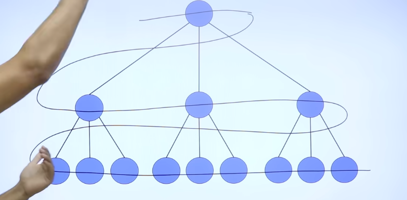
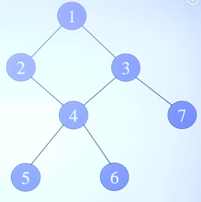

The process of visiting and exploring a graph for processing data is called graph traversal 
we have 2 

visiting the vertex and exploring the vertex 
(search)

Breadth  first search ( bfs) level by level ? 

Depth first search ( dfs )

for this question 

bfs will be 

1. we use the fifo in the bfs(queue)

so bfs 

1,2,3,4,7 5,6 (traversse via width only )

dfs : 

in dfs we geneally use stack data strucuture

1,2 4 5 ,( then go to sibling)

1,2,4,5<->6,3,7 